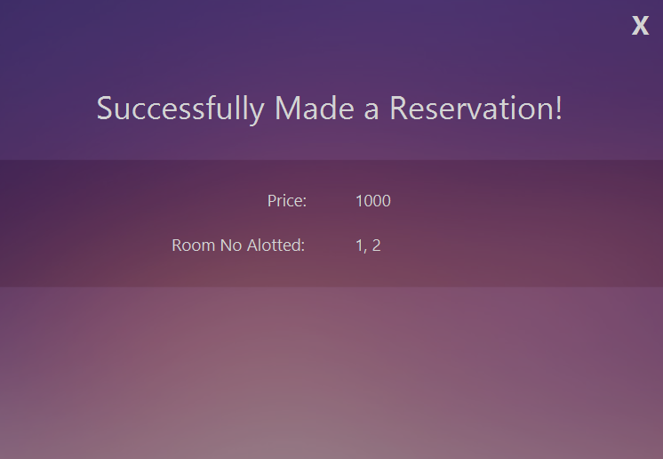

# VBook Hotel Reservation System

VBook is a desktop hotel reservation application built with Java and JavaFX. It models the workflows of a multi-role booking system while keeping the original three-layer architecture and CSV-based persistence intact.


## Features

| Role | Capabilities |
| --- | --- |
| Customer | Create an account, sign in, search hotels, and reserve rooms |
| Vendor | Create an account, advertise hotels, and review activity |
| Receptionist | Register customers and vendors, advertise hotels, and reserve rooms for customers |
| Administrator | View, edit, and delete customer, vendor, receptionist, and hotel records |

## Architecture

The application follows a three-layer architecture:

- **Presentation layer** — JavaFX controllers, FXML views, styles, and image assets.
- **Logic layer** — domain models and reservation workflows for users, hotels, rooms, and bookings.
- **Data layer** — CSV readers and writers used by the application at runtime.

See [Architecture](docs/ARCHITECTURE.md) for a more detailed map of the codebase.

```text
src/main/java/           JavaFX controllers and application logic
src/main/resources/      FXML views, styles, and image assets
data/                    Local runtime CSV storage
```

## Run locally

### Prerequisites

- JDK 15 or newer
- A matching [JavaFX SDK](https://openjfx.io/openjfx-docs/)
- An IDE with JavaFX support, such as IntelliJ IDEA

### IntelliJ IDEA setup

1. Open the repository root as a project and mark `src/main/java` as a source root and `src/main/resources` as a resources root.
2. Add the JavaFX SDK `lib` directory under **Project Structure → Libraries**.
3. Create a run configuration for `presentationLayer.Main`.
4. Set the working directory to the repository root.
5. Add these VM options, replacing the placeholder with your JavaFX SDK path:

   ```text
   --module-path /path/to/javafx-sdk/lib --add-modules javafx.controls,javafx.fxml
   ```

6. Run `presentationLayer.Main`.

CSV files are created in `data` as the application is used. They are intentionally ignored because they may contain local account and booking data.

## Screenshots

| Home | Sign in |
| --- | --- |
|  |  |

| Sign up | Reserve a room |
| --- | --- |
|  |  |

| Reservation details | Administration |
| --- | --- |
|  |  |

## Project status

This repository preserves the original team implementation. CSV storage and plaintext credentials make it suitable for local execution and architecture review, not production deployment. A production version would use a database, password hashing, validation, automated tests, and a packaged build.

## Contributors

- [Sameet Asadullah](https://github.com/SameetAsadullah)
- [Tayyab Ali](https://github.com/DarkDragz)
- [Aysha Noor](https://github.com/ayshanoorr)
- [Syed Hamza Tahir](https://github.com/S-Y-3-D)

## License

Licensed under the [MIT License](LICENSE).
